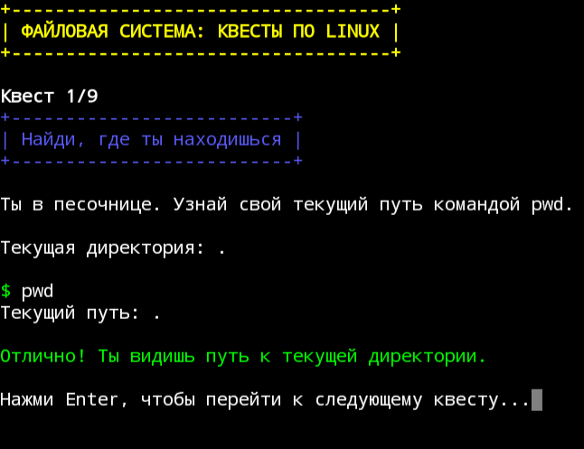
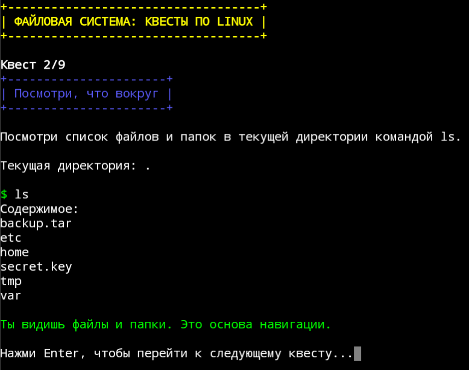
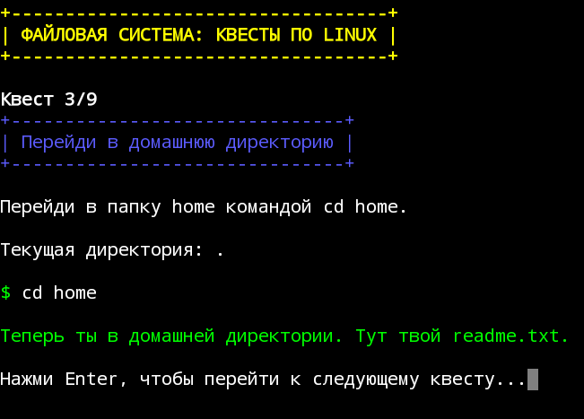
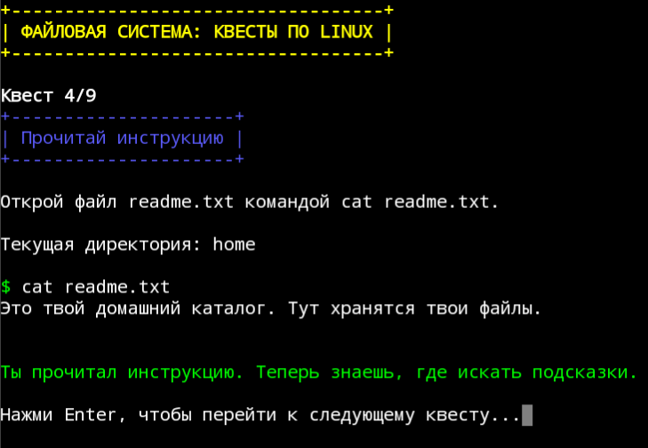
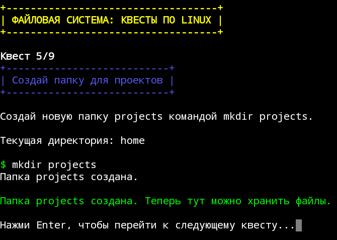
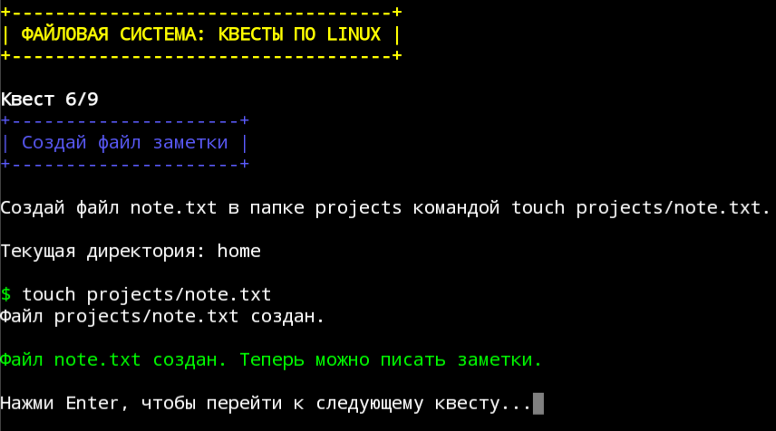
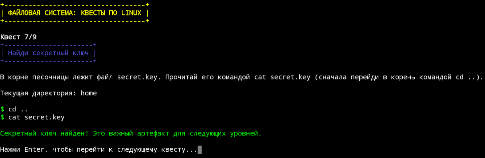
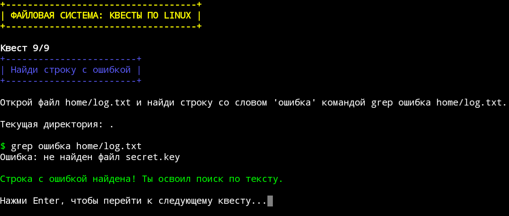
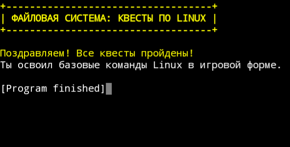

# Filer Quest

> Learn Linux-style commands through virtual filesystem quests.

| Project Information | Details |
|---|---|
| Project ID | NS-018 |
| Direction | Infotech |
| Development Phase | Phase II |
| Version | v2.0 |
| Platform | Windows / Python |
| Status | Completed |

> 

## 📖 Overview

Filer Quest is an educational terminal simulator for practicing basic filesystem operations in a virtual environment. The updated implementation offers 25 quests and a free practice mode without executing real shell commands.

## ✨ Features

- 25 interactive quests with hints

- Virtual filesystem navigation and file management

- Free practice mode

- Persistent local progress

- Input validation and virtual path handling

## 🛠 Technology Stack

- Python
- JSON
- Python standard library

## 📦 Installation

- Download the Windows executable from Releases: [more...](https://github.com/NebulaStack-prog/Filer-Quest/releases/tag/v2.0)

- Or run with Python latest version of code: [more...](FilerQuest-New.py)

- Original source code (Old): [more...](FilerQuest.py)

## 📄 Documentation (For old code)

- Russian documentation: [more...](FQ_RU.md)

- English documentation: [more...](FQ_EN.md)

## 📊 Project Status

A completed NESTIMS Phase II project. Both the original and updated Python implementations are preserved.

## 📷 Screenshots

© NESTIMS
